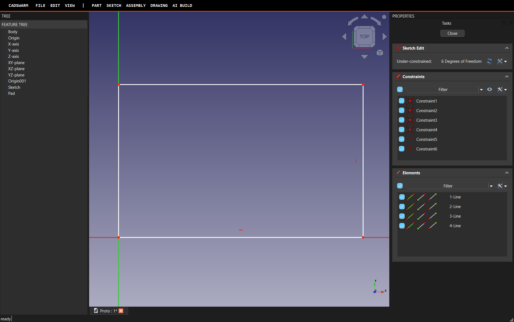

# CADSwarm as a standalone desktop CAD application

Status: architecture chosen and prototyped (branch `feat/standalone-app`). Build phase waits for review.

## Goal

A user installs and launches **CADSwarm**. They never see FreeCAD's window, menus, start page, workbench
switcher, splash or branding. FreeCAD is the geometry kernel (OCCT, sketch solver, PartDesign, Assembly,
TechDraw, FEM) and nothing more. Everything that works today stays: step-by-step AI build, multiplayer
(team, presence, pointers, locks, chat, handoff), components library, reviewer, FEA/lattice, phone web view.

## Options considered

| | A. Own Qt app, FreeCAD GUI as a library | B. FreeCAD exe, custom startup/branding | C. Headless FreeCAD + Tauri/three.js shell |
|---|---|---|---|
| Real interactive modelling (pick faces/edges, sketcher with solver, edit features) | **Yes**, FreeCAD's own 3D view and task dialogs | Yes | Must be rebuilt in the browser: sketch editor, constraint UI, B-rep picking with stable refs, every feature dialog |
| Fully custom chrome | **Yes**: our QMainWindow; FreeCAD's never shown | Partial: FreeCAD's QMainWindow restyled; menus and workbench machinery fight back on every activation | Yes |
| Hides FreeCAD branding | **Yes**: no splash (we never run freecad.exe), own settings dir, own app id/icon | Needs `branding.xml` inside FreeCAD's install folder, or flashes FreeCAD's splash | Yes |
| Reuses existing work | Python core, MCP hub, host, `cadswarm/gui` panels (Qt) | Same | Web workspace |
| Fragility | Two documented traps (below), both fixed in the prototype | Highest: every FreeCAD update can change menus, toolbars and dock behaviour we hide | Lowest at runtime, but months of CAD-UI rebuild |

**Decision: A.** It is the only option with a fully custom UI *and* FreeCAD's real interactive modelling, and
the prototype shows its risky part works. C stays the phone/browser view (it already is), not the desktop.

## How A works (`cadswarm/app/engine.py`)

1. The launcher runs **FreeCAD's bundled Python** (`pythonw -m cadswarm.app`). There is no `freecad.exe`, so
   no FreeCAD splash, title or taskbar entry. We set our own AppUserModelID (`CADSwarm.Desktop`) and icon.
2. `FREECAD_USER_HOME` points at `%APPDATA%\CadSwarm\engine` (macOS/Linux equivalents), so the engine has its
   own parameters, never touches the user's FreeCAD profile, and the first-run and Start pages are switched off
   before the GUI starts (`ENGINE_PARAMS`).
3. `FreeCADGui.showMainWindow()` creates FreeCAD's main window, which is hidden immediately and never shown.
4. We **adopt** two widgets into our own `QMainWindow`:
   - the **MDI area** (the 3D views: Coin/Quarter viewer, picking, preselection, view cube, sketch editing);
   - the **Tasks dock**, the task panel the sketcher and feature dialogs open into.
5. Everything else (title bar, ribbon, feature tree, property panel, status bar, file menu, keymap) is ours,
   driven by FreeCAD's Python API (`App`, `Gui.Selection`, `Gui.runCommand`, document observers).

### Traps found while prototyping

- `DockWindowManager.getDockWindow("Tasks")` returns the dock's *current* `widget()`. Taking the TaskView out
  of its QDockWidget made sketch edit open **no** dialog. Fix: re-parent the whole QDockWidget (title bar
  hidden, not dockable) as a plain child of our layout.
- The first-run and Start pages open as MDI tabs unless `Mod/Start/ShowOnStartup` and `FirstStart2024` are
  false. They are preset in our engine profile.
- Python's interpreter teardown after FreeCAD's GL objects crashes. The entry point closes documents and
  exits with `os._exit`.

### Known follow-ups (handled in the build phase)

- **Shortcuts:** FreeCAD's QActions belong to the hidden window, so their shortcuts never fire. We own the
  keymap (`QShortcut` on our window → `Gui.runCommand`), which we want anyway (research §4, keymap table).
- **Dialogs** parented to the hidden window centre on it. We set `Gui.getMainWindow().setGeometry` to match
  our window so they appear over CADSwarm.
- **Status text** (preselection, command hints) is relayed from FreeCAD's status bar signal.

## Structure

```
cadswarm/app/            desktop app (runs in FreeCAD's Python)
  engine.py              boot, settings home, adopt MDI + Tasks dock, shutdown
  __main__.py            entry point, test hooks (--demo --shot --quit-after)
  shell.py               main window: title bar, ribbon, panes, status bar
  ribbon/ tree/ props/   ribbon per environment, feature tree, property panel
  sketch/ nav/ files/    sketch mode, navigation + keymap, File menu/import/export
  build/ team/           AI Build pane (step plan), multiplayer (reuses cadswarm/gui panels)
design/tokens.json       ONE source of design tokens → generated Qt QSS + web CSS variables
install/                 Windows installer + launchers for macOS/Linux
```

## Design system

Brutalist, per the research (§5): strict 4px grid, 2px solid black structure borders, no radius, no shadows,
uppercase mono labels, a grotesk for headings, black/white plus signal orange (active/AI) and red (errors),
with a dark variant. Tokens live in `design/tokens.json`; a generator writes the Qt stylesheet and the web CSS
so the desktop app, web workspace and phone view always match.

## Build plan (after review)

Parallel agents, each owning separate directories: (1) app shell + files + installer, (2) ribbon/tree/property
panel/sketch/navigation, (3) AI Build + multiplayer port, (4) design tokens + web/phone restyle. Each milestone
is run in real FreeCAD and screenshotted before it counts as done.


